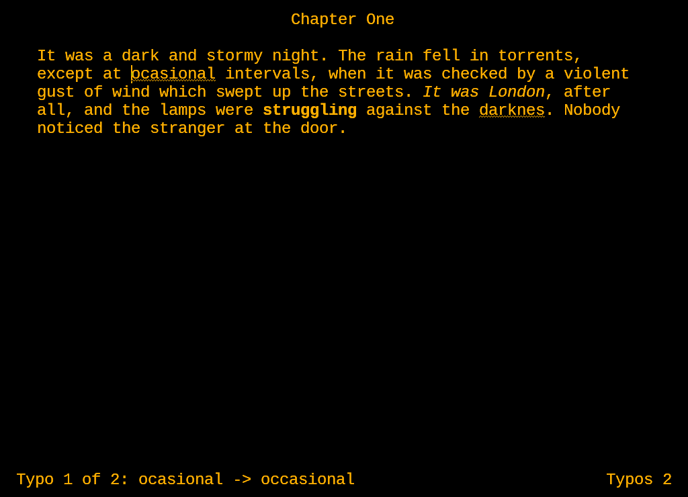

# Amber Writer

A distraction-free word processor that looks and feels like WordPerfect for DOS on an
amber monochrome monitor: amber text on a black screen, a 65-column page, the
WordPerfect keys, a typewriter beep for typos, and nothing else to look at.

It runs on Windows (XP to 11), macOS (12 Monterey and later, Apple silicon and Intel)
and Linux. Amber Writer is free software under the GNU General Public License v3.



## Download and run

Get the file for your computer from the [Releases page](../../releases/latest).

- **Windows**: `AmberWriter-<version>-windows.zip`. Copy `AmberWriter.exe` anywhere (the
  desktop, a USB stick) and double-click it. You can also drag a document onto it. It
  uses only plain Windows calls, so it runs on Windows XP through 11 with nothing to
  install. Windows 10 and 11 may warn that it comes from an unknown publisher: click
  More info, then Run anyway.
- **Mac**: `AmberWriter-<version>-mac.dmg`. Open it and drag Amber Writer onto
  Applications. Amber Writer isn't sent to Apple for checking, so the first time macOS
  stops it: click Done, open System Settings > Privacy & Security, click Open Anyway
  next to "Amber Writer was blocked", and confirm. After that it opens normally. On a Mac,
  Cmd does what Ctrl does below, and Option (or Control) does what Alt does; on a laptop,
  hold fn for the F keys.
- **Linux**: `AmberWriter-<version>-x86_64.AppImage`, one file that runs on Ubuntu 22.04,
  Debian 12, Fedora 36 and later. Make it executable (in the file's Properties, or
  `chmod +x AmberWriter-*.AppImage`) and double-click it, or run it with a document's name.

## Finding the commands

Every command has a key, and there are three ways to find them:

- **Tap Alt** (or press Alt+=) for a WordPerfect 5.1 style menu bar across the top: File,
  Edit, Search, Layout, Font, Tools, View and Help. Left and Right change menus, Up and Down move,
  Enter chooses, Esc closes, and the underlined letters work as shortcuts (Alt, O, B is
  bold). Each item shows its key. The mouse works too, and right-clicking the page or
  clicking the status line also opens the menu.
- **Hold Ctrl or Alt** for a moment and the keys that go with it appear across the top,
  with the function keys below, like the template that sat above WordPerfect keyboards.
  Let go and it disappears.
- **F3** shows every key on one screen.

A faint reminder (`Alt: menu`) sits on the status line; View > Hints turns it off.

## Keys

| Key | Does |
| --- | --- |
| Alt (tap) / Alt+= | Menu |
| F3 | Help screen |
| F10 / Ctrl+S | Save as / Save |
| Shift+F10 / Ctrl+O | Retrieve (open) a document |
| Shift+F7 / Ctrl+P | Print |
| F7 / Ctrl+Q | Exit |
| Alt+N / Alt+P | Jump to the next / previous typo |
| Ctrl+F2 | Spell check from the cursor, with numbered suggestions |
| F2 / Shift+F2 | Search forward / back (in the prompt, F2 or Enter searches, so F2 F2 finds the next one) |
| Alt+F2 | Replace a word or name everywhere |
| Ctrl+F / Ctrl+H | Search / replace, for people used to Windows keys |
| Ctrl+B or F6 / Ctrl+I | Bold / italics |
| Ctrl+U or F8 / Ctrl+Shift+X | Underline / strikethrough |
| Shift+F6 or Ctrl+E | Center the line (press again to put it back at the left) |
| Alt+F6 or Ctrl+R | Flush right (press again to put it back at the left) |
| Ctrl+L | Back to the left |
| Alt+A | Add the word at the cursor to your personal dictionary |
| Alt+B | Beep on or off |
| Ctrl+= / Ctrl+- | Bigger or smaller text |
| F11 | Full screen |
| Ins | Typeover on or off |

## Centering and flush right

Shift+F6 centers the paragraph the cursor is in, the way WordPerfect 5.1 did, and Alt+F6
pushes it to the right margin. Select several paragraphs first to do them all at once.
Type a title on a centered line and press Enter: the next line starts back at the left,
so you can carry straight on with the text. Pressing Enter in the middle of a centered
paragraph keeps both halves centered. Each paragraph's alignment is saved in `.rtf` and
`.docx` files; `.txt` files have no alignment. Justified paragraphs in a document you
open stay justified.

## Printing

Shift+F7 (or Ctrl+P, or File > Print) opens the usual Windows print dialog, where you
choose the printer, the number of copies, and whether to print everything, some pages
or just the selected text. Pages come out black on white in Courier New 12 point, ten
characters and six lines to the inch like WordPerfect 5.1, so the 65 columns make a
6.5 inch line with 1 inch margins on letter paper, lines break where they do on the
screen, and each page holds the 54 lines the status line counts. Bold, italics,
underline, strikethrough, centered and flush right lines all print; the typo
underlines don't. On A4 paper the side margins are a little narrower and a page holds
58 lines.

## Documents

Documents are saved as Rich Text (`.rtf`), which keeps bold, italics, underline and
strikethrough, centered and flush right lines, and opens in every version of Word, in WordPad and in LibreOffice. Type a
name ending in `.docx` to save a Word file instead, or `.txt` for plain text (formatting
is dropped). A name without a folder goes in your (My) Documents folder.

Retrieve opens `.rtf`, `.docx` and `.txt` files, including the `.docx` files the Python
version saved. Typing a name without an extension finds `story.rtf`, `story.docx` or
`story.txt`.

## Spelling

The English (US) dictionary is built in, the same word list the Python version uses. A short
beep sounds when you finish a word that is not in it (never while you Backspace), and the
word gets a wavy amber underline that stays until it is fixed. Put the cursor on an
underlined word and the bottom left shows suggestions, for example
`mispeled -> misled, misspelled, dispelled`. The bottom line counts the typos, and Alt+N and
Alt+P go from one to the next (`Typo 3 of 7: ...`).

## Search and replace

F2 asks `-> Srch:` and selects the next match; Shift+F2 searches back. Case does not
matter, and the bottom line says which match it is (`Found 2 of 9`). Searching goes round
to the top when it reaches the end.

Alt+F2 replaces a word or name all through the document. It asks whether to confirm each
one (Y replaces, N skips, A does all the rest, Esc stops), what to search for, and what
to replace it with. It changes whole words only, so replacing Ann leaves Anne and
planning alone, and it keeps capitals: john, John and JOHN become peter, Peter and PETER.
Ctrl+Z undoes the changes one at a time.

Your own words go in `%APPDATA%\AmberWriter\AmberWriter\words.txt` on Windows,
`~/Library/Application Support/AmberWriter/AmberWriter/words.txt` on a Mac and
`~/.local/share/AmberWriter/AmberWriter/words.txt` on Linux. Settings (beep, text size)
are kept in the registry under `HKEY_CURRENT_USER\Software\AmberWriter` on Windows, and
in Amber Writer's preferences file on a Mac and on Linux.

## Fonts

Amber Writer uses the first of these that is installed: Perfect DOS VGA 437,
Px437 IBM VGA 8x16, then Consolas, Lucida Console or Courier New on Windows, Menlo or
Monaco on a Mac, and DejaVu Sans Mono or Liberation Mono on Linux. Install one of the
first two for the most authentic DOS look. On a small screen the text shrinks so the
65-column page still fits.

## Build it

Every push to GitHub builds all three versions (`.github/workflows/build.yml`). When
the version in `src/version.h` has no release yet, they go on a new release page with
`RELEASE-NOTES.md` as its text, so raising the version publishes the next release.

**Windows**, on Linux (Ubuntu/Debian) with the 32-bit mingw-w64 cross compiler:

```
sudo apt install gcc-mingw-w64-i686 make
make                 # makes AmberWriter.exe
make test            # file format and spelling tests (needs wine)
```

**Linux**, with Qt 6 and CMake:

```
sudo apt install cmake qt6-base-dev
cmake -B build-qt -DCMAKE_BUILD_TYPE=Release && cmake --build build-qt
ctest --test-dir build-qt          # the same tests
./build-qt/amberwriter
sudo sh unix/build-appimage.sh     # the AppImage, best run on Ubuntu 22.04
```

**Mac**, with Xcode's command line tools, CMake and Python 3: `sh unix/build-mac.sh`
downloads Qt and makes `AmberWriter-<version>-mac.dmg`.

`tools/make_dict.py` rebuilds `src/dict_data.c` from the pyspellchecker word list, and
`tools/make_icon.py` redraws the icons.

## How it works

- `src/doc.c`: RTF, Word and text files, and the line breaking used for printing. Word
  files are zip archives, so this has its own small zip reader and writer and an inflate
  based on Mark Adler's puff.c.
- `src/spell.c`: dictionary lookup and suggestions (one or two edits away, most common first).
- These two are the same on every system, so documents and typos come out the same.
  `src/port.h` and `src/port.c` stand in for the few Windows calls they use on a Mac and
  on Linux.
- `src/amber.c`: the Windows version's window, page (a RichEdit control), status line,
  prompts, keys, amber caret, wavy underlines and printing. It links only against DLLs
  that come with Windows XP. `src/beep.c` makes the typewriter beep.
- `src/amber_qt.cpp`: the same screen for macOS and Linux, written with Qt 6 Widgets.
  `src/beep_unix.c` plays the beep through PulseAudio or ALSA on Linux and as a system
  sound on a Mac.

## License

Amber Writer is free software: you can share it and change it under the terms of the
GNU General Public License, version 3 (see `LICENSE`). It comes with no warranty. The
Mac and Linux versions include Qt, under the GNU Lesser General Public License v3 (see
`LICENSE.Qt-LGPL-3` and `THIRD-PARTY-NOTICES.txt`).
